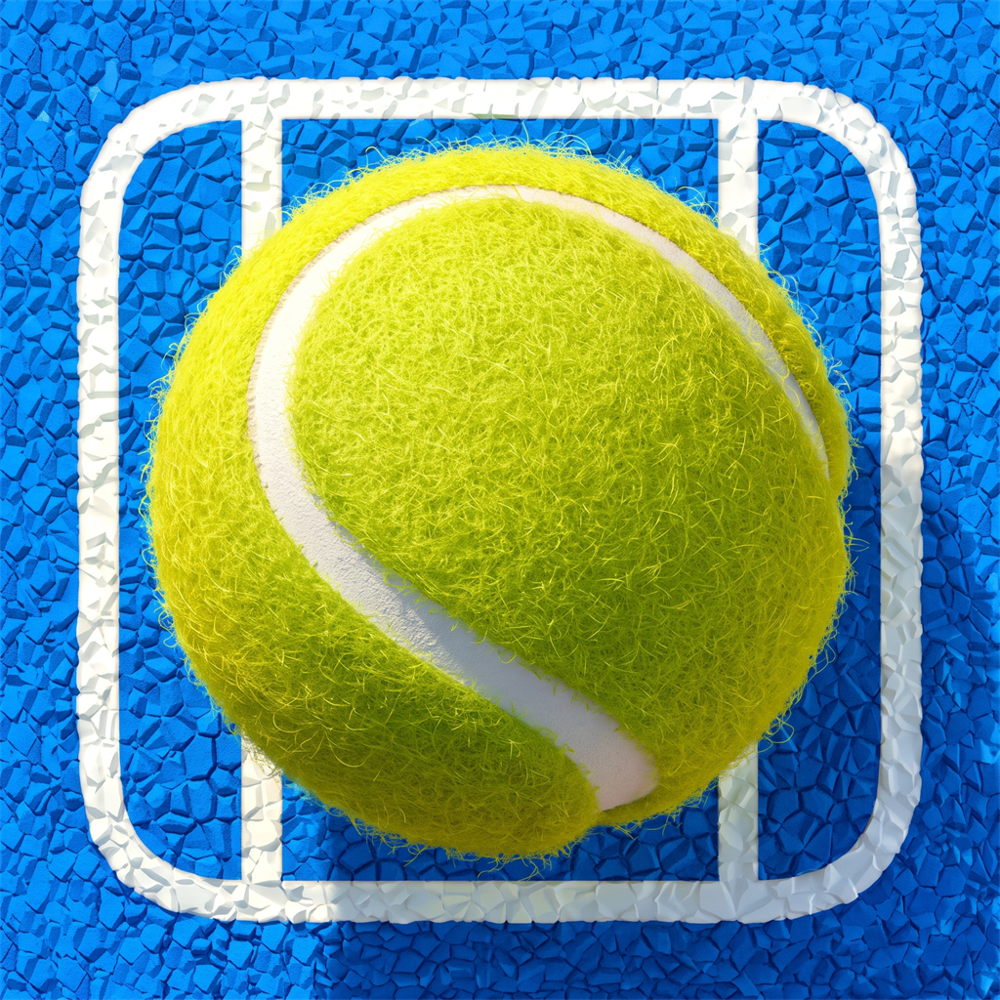

<p align="center">
  
</p>

<h1 align="center">PadelLive</h1>

<p align="center">
  <a href="https://github.com/EleonoraGiangrandi/PadelLive/releases/latest"></a>
  <a href="LICENSE"></a>
  <a href="https://expo.dev/"></a>
  <a href="https://reactnative.dev/"></a>
  <a href="https://www.typescriptlang.org/"></a>
  <a href="https://github.com/EleonoraGiangrandi/PadelLive/releases/latest"></a>
</p>

<p align="center">
  Open-source mobile application for real-time tracking of international padel tournaments, live point-by-point scores, bracket draws, match statistics, official FIP world rankings, and news.
</p>

Built with React Native and Expo in TypeScript, PadelLive is architected as a decentralized, client-only application. It queries live data directly from official circuit sources (Premier Padel and FIP Tour) without middleman servers, tracking scripts, or user account requirements.

---

## Table of Contents

- [Features](#features)
- [Download and Installation](#download-and-installation)
  - [System Requirements](#system-requirements)
  - [Installation Steps](#installation-steps)
  - [Troubleshooting Play Protect](#troubleshooting-play-protect)
- [Architecture and Privacy](#architecture-and-privacy)
- [Tech Stack](#tech-stack)
- [Project Structure](#project-structure)
- [Local Development](#local-development)
  - [Prerequisites](#prerequisites)
  - [Installation](#installation)
  - [Development Server](#development-server)
  - [Code Quality](#code-quality)
- [Building the Production APK](#building-the-production-apk)
  - [Cloud Build with EAS](#cloud-build-with-eas)
  - [Local Build with Android SDK](#local-build-with-android-sdk)
- [Alternative Distribution](#alternative-distribution)
- [Contributing](#contributing)
- [License](#license)

---

## Features

- **Tournament Tracking**:
  - Browse live, upcoming, and completed tournaments across the Premier Padel and FIP Tour circuits.
  - Filter tournaments dynamically by category (Major, P1, P2, Platinum, Gold, Star, Rise, Promotion).
  - Search competitions by name, host city, or country.

- **Live Scores and Match Statistics**:
  - Real-time point-by-point scoreboard with game state progression (15, 30, 40, Advantage).
  - Visual service indicator and tie-break tracking.
  - Detailed match metrics (break points converted, aces, double faults, service and return efficiency).
  - Adaptive polling intervals for active matches to balance real-time updates and battery usage.

- **Interactive Tournament Draws**:
  - Complete men's and women's brackets organized by rounds (Round of 64 through Finals).
  - Visual bracket exploration with match status, player pairings, and seed information.
  - Direct access to official tournament draw documents.

- **Broadcast Schedules and Live Streams**:
  - Direct links to official broadcast streams, YouTube channels, and rights holders.
  - Regional broadcasting rights reference guide.

- **Favorite Players and Push Notifications**:
  - Bookmark players to monitor upcoming and active matches.
  - Filter active tournament schedules to show matches involving followed players.
  - Local device notifications for match starts, set completions, and final results.

- **Official FIP World Rankings**:
  - Up-to-date official men's and women's rankings.
  - Rank movement indicators reflecting weekly position changes.
  - Search by player name or nationality.
  - Dedicated athlete profiles with biographical data, partner history, and career highlights.

- **News Feed and Multilingual Support**:
  - Curated news feed covering tournament reports, player interviews, and circuit updates.
  - Fully localized in English, Spanish, and Italian.
  - System-aware Dark Mode and Light Mode interface.

---

## Download and Installation

PadelLive is distributed as a standalone Android APK directly through GitHub Releases. No Google Play Store account is required.

### System Requirements

- **Operating System**: Android 8.0 (API Level 26) or higher.
- **Storage**: Minimum 40 MB of free storage space.
- **Network**: Active internet connection for live score updates.

### Installation Steps

1. **Download the APK**:
   Visit the [latest release page](https://github.com/EleonoraGiangrandi/PadelLive/releases/latest) on your mobile device and download `PadelLive.apk` under the **Assets** section.

2. **Allow Installation from Unknown Sources**:
   Android restricts installations from outside the Play Store by default on a per-application basis (e.g., Chrome, Firefox, or Files app):
   - Open your device **Downloads** or tap the completed download notification.
   - If prompted with *"For your security, your phone is not allowed to install unknown apps from this source"*, tap **Settings**.
   - Enable **Allow from this source**.
   - Return to the previous screen and select **Install**.

### Troubleshooting Play Protect

Because PadelLive is distributed directly from its open-source repository without a proprietary Google commercial certificate, Google Play Protect may display a warning dialog (*"Blocked by Play Protect"* or *"Unrecognized Developer"*):

1. On the Play Protect dialog, tap **More details** (or **More info**).
2. Tap **Install anyway**.
3. Once the installation completes, tap **Open** to launch the application.

---

## Architecture and Privacy

PadelLive is designed around privacy and decentralization principles:

- **No User Account Required**: The app is fully functional upon installation with no registration, sign-in, or telemetry collection.
- **Local-Only Storage**: All user preferences, followed players, and cache are stored exclusively on your device using local storage (`AsyncStorage`). No data is sent to external proprietary backends.
- **Direct Circuit Connectivity**: Match data, tournament schedules, and ranking tables are requested directly from official sporting data feeds.

---

## Tech Stack

- **Framework**: [React Native](https://reactnative.dev/) (v0.88) with [Expo](https://expo.dev/) (SDK 58)
- **Language**: [TypeScript](https://www.typescriptlang.org/) (Strict mode)
- **Navigation**: [React Navigation](https://reactnavigation.org/) (Native Stack and Bottom Tabs v7)
- **State Management**: [Zustand](https://github.com/pmndrs/zustand) with persistent local storage
- **Data Fetching**: [TanStack Query](https://tanstack.com/query/latest) (React Query v5)
- **UI & Icons**: [Lucide React Native](https://lucide.dev/), `react-native-safe-area-context`, `react-native-screens`
- **Notifications**: `expo-notifications`
- **Build System**: Expo Application Services (EAS Build)

---

## Project Structure

```
padel-score/
|-- assets/              # Application icons, splash screens, and images
|-- src/
|   |-- api/             # HTTP clients, parsers, and official circuit endpoints
|   |-- components/      # Reusable UI components (draws, match cards, rankings)
|   |-- constants/       # Color palettes, theme definitions, and layout constants
|   |-- hooks/           # Custom React hooks for queries, storage, and filters
|   |-- i18n/            # Internationalization dictionaries (EN, ES, IT)
|   |-- navigation/      # Stack and bottom-tab navigation definitions
|   |-- screens/         # Top-level screen components
|   |-- services/        # Background polling, local notifications, and match trackers
|   |-- store/           # Zustand state slices and storage persistence
|   |-- types/           # TypeScript interfaces and data models
|   |-- utils/           # Helper functions for dates, formatting, and calculations
|-- app.json             # Expo application configuration
|-- eas.json             # EAS build profiles and configuration
|-- package.json         # Project metadata and dependencies
|-- tsconfig.json        # TypeScript configuration
```

---

## Local Development

### Prerequisites

- [Node.js](https://nodejs.org/) (v18.x or later)
- Package manager: `npm` or `bun`
- [Expo Go](https://expo.dev/go) on a physical mobile device, or an Android Studio emulator / iOS Simulator

### Installation

1. Clone the repository:
   ```bash
   git clone https://github.com/EleonoraGiangrandi/PadelLive.git
   cd PadelLive
   ```

2. Install dependencies:
   ```bash
   npm install
   ```

### Development Server

Start the Metro bundler:
```bash
npx expo start
```

Press:
- `a` to open in an Android emulator or connected device.
- `i` to open in an iOS simulator (macOS required).
- Scan the printed QR code using the Expo Go application on Android.

### Code Quality

Run static analysis and type checks:
```bash
# TypeScript type check
npx tsc --noEmit

# ESLint code analysis
npx expo lint
```

---

## Building the Production APK

PadelLive is pre-configured with Expo Application Services (EAS) to build standalone Android APK files directly.

### Cloud Build with EAS

1. Install EAS CLI globally:
   ```bash
   npm install -g eas-cli
   ```

2. Authenticate with your Expo account:
   ```bash
   eas login
   ```

3. Trigger the production APK build on EAS servers:
   ```bash
   eas build -p android --profile production
   ```
   Upon completion, EAS provides a direct link to download the compiled `.apk` file.

### Local Build with Android SDK

To compile the APK locally without using cloud build resources, ensure the Android SDK and JDK 17+ are installed and configured:
```bash
eas build -p android --profile production --local
```

The resulting `.apk` file will be generated in your project root.

---

## Alternative Distribution

Beyond manual installation via [GitHub Releases](https://github.com/EleonoraGiangrandi/PadelLive/releases), PadelLive can be integrated into community-driven Android repositories:

- **IzzyOnDroid (F-Droid Community Repository)**:
  IzzyOnDroid is an open-source Android app repository compatible with F-Droid and Neo Store clients. It tracks GitHub Releases automatically and serves APKs to users without rebuilding code. Inclusion requests can be submitted via the [IzzyOnDroid repository tracker](https://gitlab.com/IzzyOnDroid/repo/-/issues).

---

## License

This project is licensed under the [MIT License](LICENSE).
